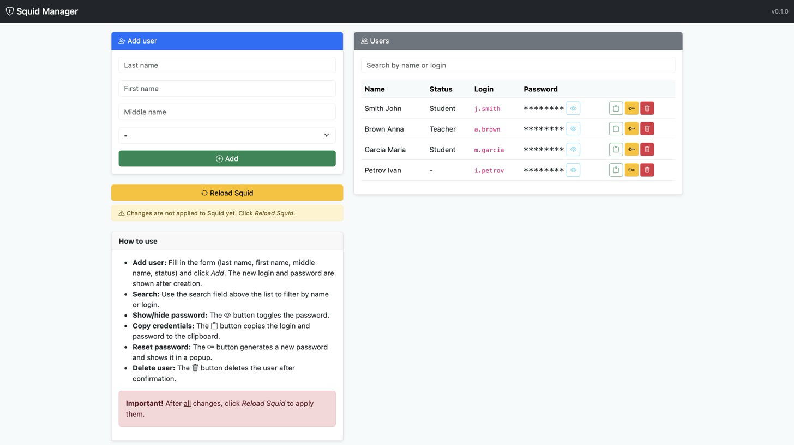

# Squid Manager

A small web panel for managing Squid proxy users: add and delete users, reset
passwords, and apply the changes to Squid with one button. Logins are generated
from names (`Ivan Petrov` → `i.petrov`, Cyrillic is transliterated). The proxy
listens on port `3128` with Basic authentication and a domain whitelist.



## Project Structure

```text
.
├── .github/workflows/ci.yml      # checks, package build, install test, releases
├── VERSION                       # current version
├── CONTRIBUTING.md               # development setup and releases
├── LICENSE                       # MIT
├── pyproject.toml                # dev dependencies and tool settings
├── nfpm.yaml                     # .deb package definition
├── install.sh                    # installer for the .tar.gz release
├── panel/                        # the web panel: app.py and static/index.html
├── config/                       # Squid drop-in config and whitelist
├── packaging/                    # setup.sh, systemd unit, settings template, deb scripts
├── tests/                        # unit tests and the installed-system smoke test
└── docs/images/
```

## Installation

On Ubuntu 22.04, Ubuntu 24.04, or Debian 12, download the latest package and
install it:

```bash
wget https://github.com/vitlixe/squid-manager/releases/latest/download/squid-manager.deb && sudo apt install ./squid-manager.deb && rm squid-manager.deb
```

The package pulls in Squid and prints the generated admin password on the first
install. Update with the same command; users, settings, and whitelist edits are
kept. Remove the panel with `sudo apt remove squid-manager`;
`sudo apt purge squid-manager` also deletes users and settings.

For a specific version, replace `latest/download` with `download/v0.1.0`. Each
release also has `checksums.sha256` for `sha256sum -c`. The installed version is
stored in `/opt/squid-manager/VERSION`.

Open the proxy port if clients connect from other machines:

```bash
sudo ufw allow 3128/tcp
```

## Configuration

Everything you edit lives in `/etc/squid-manager/`. Panel settings are in
`/etc/squid-manager/squid-manager.env`:

| Variable | Default | Description |
|---|---|---|
| `SQUID_MANAGER_LOGIN` | — | Admin login; all requests are rejected while it is empty. |
| `SQUID_MANAGER_PASSWORD` | — | Admin password, generated by the installer. |
| `SQUID_MANAGER_HOST` | `127.0.0.1` | Address the panel listens on. |
| `SQUID_MANAGER_PORT` | `5000` | Port the panel listens on. |
| `SQUID_MANAGER_USERS_FILE` | `users.json` | User list (`/opt/squid-manager/users.json` on the server). |
| `SQUID_MANAGER_PASSWD_FILE` | `/etc/squid/passwd` | Squid password file the panel rebuilds. |

Allowed domains are listed in `/etc/squid-manager/whitelist`, one per line;
`.github.com` also matches subdomains. After editing it, run
`sudo systemctl reload squid`. The Squid rules themselves are installed to
`/etc/squid/conf.d/squid-manager.conf`.

## Usage

Open the panel through an SSH tunnel and go to `http://127.0.0.1:5000`:

```bash
ssh -L 5000:127.0.0.1:5000 user@your-server
```

1. Add, delete, or reset users.
2. Click **Reload Squid**: changes reach Squid only after this step. Until then
   the panel shows a warning under the button. Deleted users and old passwords
   stop working within a minute after the reload.
3. Give users their credentials; they use `your-server:3128` as an HTTP proxy.

Every admin action (added, deleted, or reset users, Squid reloads, failed
logins) is logged without passwords; view it with `journalctl -u squid-manager`.

## Security Notes

- The panel runs as the `proxy` user with sudo rights limited to rebuilding the
  Squid password file and reloading Squid.
- `users.json` stores proxy passwords in plaintext so the panel can show them;
  keep it and `/etc/squid-manager/squid-manager.env` restricted.
- Do not expose the panel to the internet; use an SSH tunnel or VPN.
- On Ubuntu, the distribution `squid.conf` allows requests from the server
  itself (`localhost`) before it includes `conf.d`, so local processes can use
  the proxy without credentials; authentication and the whitelist apply to
  remote clients. Debian 12 includes `conf.d` first, so the rules cover local
  requests too.
  Squid Manager does not edit `squid.conf`, because a modified file blocks
  unattended Squid security updates. To close it, comment out
  `http_access allow localhost` in `/etc/squid/squid.conf` yourself.
- The panel service runs under systemd sandboxing (read-only `/usr`, private
  `/tmp`, no access to home directories).

## License

MIT. See [LICENSE](LICENSE).
